# 상위 지출 고객이 매출 성장을 이끌었을까? — 고객 집중도·재활성화·순위 하락 분석

[English](README.md)

## 분석 배경과 가설

매출이 증가했다면 기존에 많이 구매하던 고객이 더 많이 산 덕분일까, 아니면 다른 고객들의 지출이 늘어난 걸까? Dunnhumby 가구별 거래 데이터를 이용해 **초기에 상위 지출 고객이었던 집단을 고정한 뒤, 그 집단의 이후 구매 변화**를 추적했다.

검토한 가설은 다음 두 가지다.

- **H4-1:** 안정구간 초반 기준 상위 X% 가구의 매출 비중과 절대 지출액이 이후에 모두 증가했다.
- **H4-2:** 상위 지출 고객군에 속하는지와 신규·재활성화 가구인지가 관련되어 있다.

분석하면서 H4-1은 예상과 반대 결과가 나왔다. **초기 상위 20% 고객의 지출과 매출 비중은 줄었고, 나머지 고객군은 늘었다.** 이 결과가 기간 선택이나 집계 오류 때문인지 확인한 다음, 나머지 고객군 증가분이 신규·재활성화 고객에게서 나왔는지도 나눠 봤다. 마지막에는 처음 상위 20%였던 고객이 이후 순위에서 내려올 가능성을 예측해 봤다.

여기서 '이탈'은 반드시 거래를 완전히 중단했다는 뜻이 아니다. 예측모델의 타깃은 **후반에도 상위 20%의 지출 순위를 유지했는지**다.

### 어떤 '상위 20%'인가

분석에는 서로 관련되지만 다른 세 가지 모집단이 쓰인다. 값이 조금씩 다른 이유는 오류가 아니라 분모가 다르기 때문이다.

| 이름 | 모집단 | 가구 수 | 상위 20% | 쓰이는 분석 |
|---|---|---:|---|---|
| **집중도 표본** | 17~26주에 거래가 한 건이라도 있는 가구 | 2,272 | 로렌츠 곡선의 가구 상위 20% 지점(보간, 명확한 컷오프 없음) | 3절: 로렌츠 곡선, 지니계수, 55.4% |
| **H4-1 패널** | 17~26주와 90~99주 모두 거래가 있는 가구 | 2,095 | **419가구** (초반 지출 ≥ 582.35) | 5~9절: 집단별 변화, 검정 A~D, 54.87% → 41.96% |
| **넓은 패널** | 17~99주에 거래가 있는 모든 가구, 초반 거래가 없으면 지출 0 | 2,492 | **499가구** (초반 지출 ≥ 535.29) | 10~13절: 신규·재활성화 교차표, 14절 이후: 예측모델 |

데이터의 2,500가구 중 8가구는 17~99주에 거래가 없다(기존 7, 재활성화 1). 이들은 10절의 고객 상태 집계에는 들어가지만 넓은 패널에는 없다.

---

## 1. 상위 고객은 반드시 초반 자료로 정의

후반 지출까지 보고 상위 고객을 정하면 이미 많이 소비한 고객을 상위로 뽑은 다음 '상위 고객의 매출이 높았다'고 말하는 순환논리가 된다. 그래서 먼저 **초반 기간과 상위 비율을 결정하고 그 명단을 고정**했다.

처음부터 관례적인 상위 20%를 적용하지 않았다. 기간 길이와 지출 집중도를 데이터로 점검한 뒤 기준을 정했다.

## 2. 초반 기간 N주 결정: 홀수주·짝수주 순위 안정성

안정구간은 **17~99주(83주)**였다. 초반 N주 동안 가구별 지출을 홀수주와 짝수주로 나누어 각각 순위를 만든 다음, 두 순위의 **Spearman 상관계수**를 계산했다. N을 늘릴수록 순위가 얼마나 안정되는지 살펴보고 곡선이 완만해지는 구간을 찾았다.

초반 기간이 너무 길면 '초기'라는 의미가 약해진다. 그래서 전체 안정구간의 약 10~15%인 **8~12주**를 우선 비교 범위로 정했다.

- `kneed`가 제안한 완만해지는 지점: **10주**
- 해당 지점의 Spearman `ρ = 0.697`
- 아주 뚜렷한 변곡점은 없었고 순위에도 노이즈가 있었다.

따라서 **N = 10주**로 진행하되 **8주·12주 민감도 분석**을 병행했다.

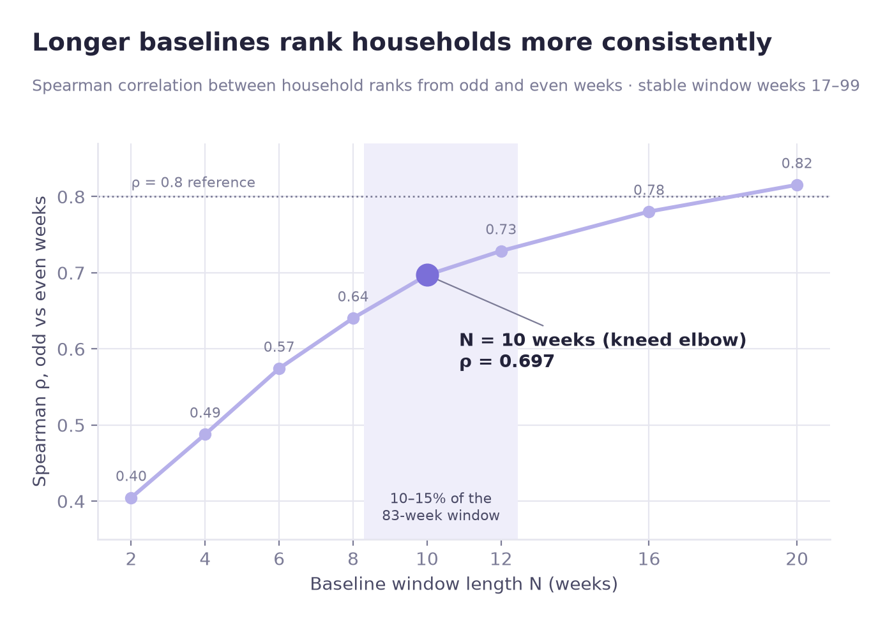

## 3. 상위 X% 결정: 지출 집중도 확인

초반 10주 동안의 가구별 누적 지출을 큰 순서대로 정렬한 다음, 상위 고객 비중이 전체 매출의 얼마를 차지하는지 계산했다.

| 지표 | 결과 |
|---|---:|
| 지니계수(Gini) | **0.532** |
| 상위 1%의 매출 비중 | 6.2% |
| 상위 10%의 매출 비중 | 36.1% |
| 상위 20%의 매출 비중 | **55.4%** |
| 상위 30%의 매출 비중 | 68.9% |
| `kneed`가 제안한 지점 | 상위 18% |

흔히 인용되는 '상위 20%가 80%의 매출을 만든다'는 패턴은 이 데이터에서는 나타나지 않았다. 지출 집중은 있었지만 80/20만큼 극단적이지 않았다. 곡선에서도 뚜렷한 한 지점에서 갑자기 꺾이는 모습은 보이지 않았다.

알고리즘이 제시한 **18%**와 해석하기 쉬운 기준인 **20%**가 가깝기 때문에, 비교할 집단은 초반 **상위 20%**로 정했다.

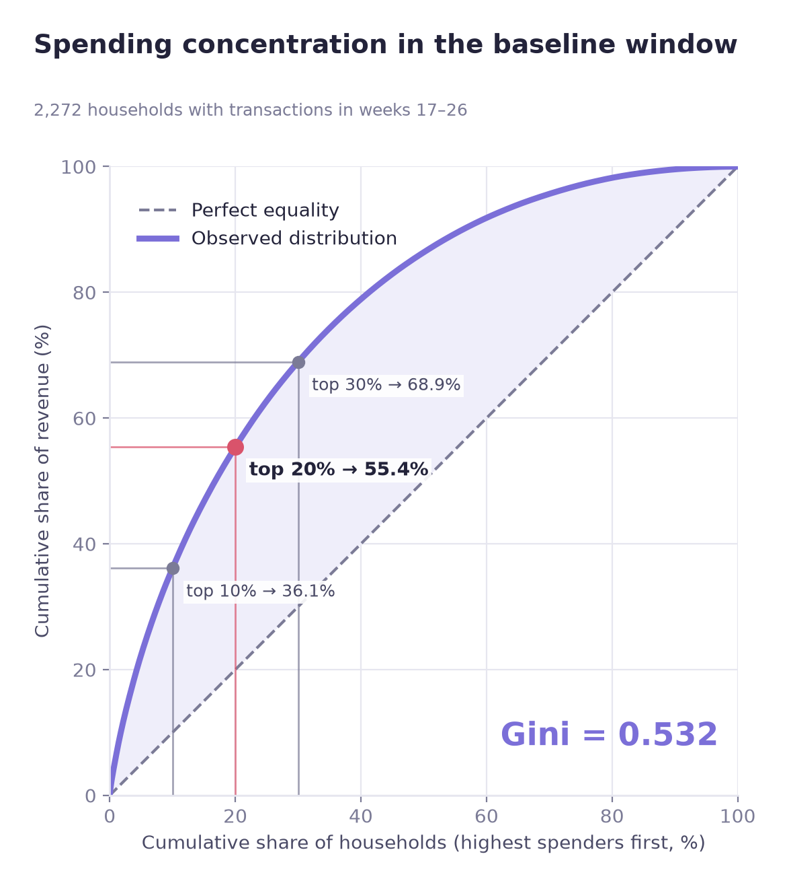

## 4. 이상치 처리

거래의 `SALES_VALUE`를 IQR 방식으로 점검했을 때 약 **7.34%**가 이상치 범위에 들어갔다. 지출 데이터는 원래 소액 거래가 많고 큰 거래가 오른쪽 꼬리를 만드는 형태여서 IQR만으로 제거하면 실제 중요한 거래까지 사라질 수 있다.

이 프로젝트에서는 상위 지출 고객을 분석하는 것이 목적이므로 높은 금액을 기계적으로 삭제하지 않았다. 대신 정규성이 충족되지 않는 경우 **Wilcoxon, Mann–Whitney U 등 비모수 검정**을 사용하고 민감도 분석으로 결론을 점검했다.

## 5. 예상과 달랐던 첫 결과

초반과 후반의 가구별 지출 변화를 같은 기준으로 구한 후, 초기 상위 20%와 나머지 80%를 비교했다.

| 초기 집단 | 가구별 평균 지출 변화(후반 − 초반) |
|---|---:|
| 상위 20% | **−111.49** |
| 나머지 80% | **+102.74** |

상위 고객의 지출이 늘었을 것이라는 H4-1과 반대였다. 다만 초반 성적이 우연히 높았던 고객은 다음 기간에 평균으로 돌아가는 **회귀효과(regression to the mean)**가 발생할 수 있다. 그래서 곧바로 '상위 고객이 위축됐다'고 결론 내리지 않고, 초반 기간을 바꾸면서 방향이 유지되는지 확인했다.

## 6. 민감도 분석: N = 8, 10, 12주

| 초반 기간 | 나머지 80% 평균 변화 | 상위 20% 평균 변화 |
|---|---:|---:|
| 8주 | +92.42 | −97.16 |
| **10주** | **+102.74** | **−111.49** |
| 12주 | +117.85 | −120.21 |

- 어느 기간을 사용해도 상위 20%는 감소, 나머지 80%는 증가했다.
- 기간별 상위 고객 명단의 **Jaccard 유사도는 0.76~0.86**으로 비교적 일관됐다.

기간 하나의 선택에만 의존한 결과는 아니었다. 하지만 이 검정만으로 평균회귀 효과가 *완전히 제거됐다*고 말할 수는 없다. 결과가 기간 변경에 얼마나 민감한지 확인한 근거로 해석했다.

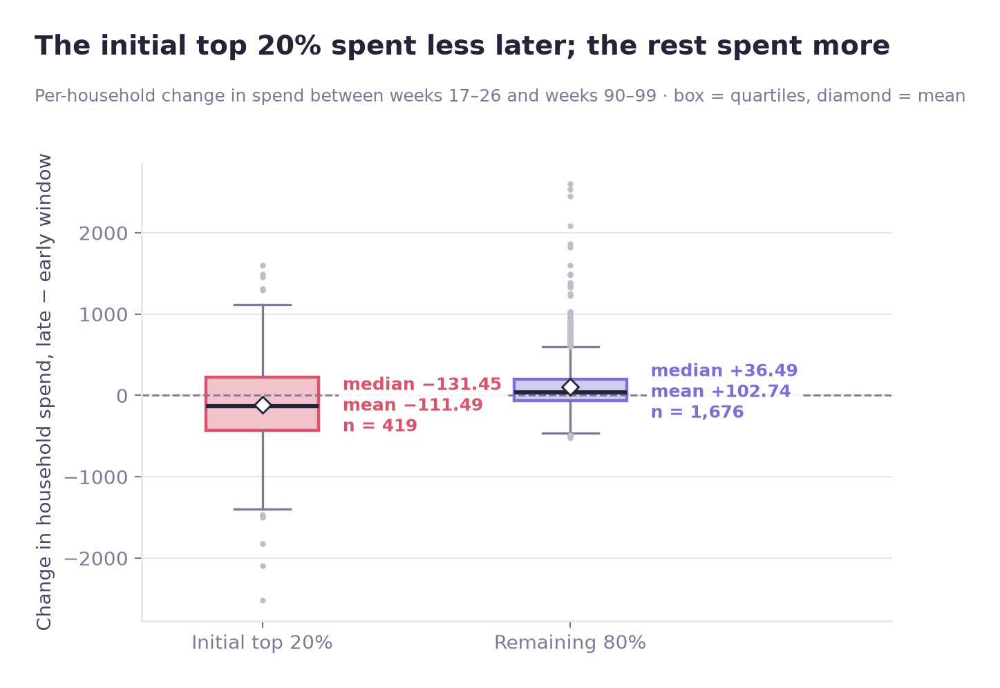

## 7. 정규성·등분산성 확인

- **Shapiro–Wilk:** 상위 20%와 나머지 80% 모두 정규성 기각
- **Levene:** 두 그룹 간 등분산성 기각; 상위 20%의 분산이 나머지 80%보다 **3배 이상** 큼

이 때문에 두 그룹의 변화량을 비교할 때 비모수 방법을 사용했다.

## 8. H4-1 검정: 금액과 비중을 따로 확인

지출의 절대액 변화, 그룹 간 변화량 차이, 전체 매출 중 상위 집단의 비중을 구분했다. 여러 가설을 함께 확인하기 위해 세 주요 검정에는 Bonferroni 보정 `α = 0.05/3 ≈ 0.0167`을 적용했다.

### A. 상위 20% 고객의 지출 변화 — Wilcoxon

- `p = 0.00002`
- 효과 크기 `r = −0.209` (감소 방향)
- 변화량 중앙값 **−131.45**
- 95% 신뢰구간이 전부 음수

초기 상위 집단의 후반 지출은 통계적으로 유의하게 감소했다.

### B. 나머지 80% 고객의 지출 변화 — Wilcoxon

- `p = 8.8 × 10⁻³¹`
- 변화량 중앙값 **+36.49**
- 95% 신뢰구간 **[23.9, 49.8]**

나머지 집단은 유의하게 증가했다.

### C. 두 집단의 변화량 차이 — Mann–Whitney U

- `p = 3.3 × 10⁻²⁰`
- 효과 크기 `r = 0.290`
- 공통언어 효과 크기 **0.355**
- 변화량 차이에 대한 95% 구간 **[−229.3, −116.0]**

이는 상위 고객군의 지출 변화가 나머지 고객군보다 작게 나타나는 경향을 보여준다. 공통언어 효과 크기 0.355는 순서를 어떻게 정의했는지와 함께 읽어야 하며, 0.5가 두 집단이 뚜렷이 구별되지 않는 기준점이다.

### D. 전체 매출에서 상위 20%가 차지한 비중 — 부트스트랩

비중은 가구마다 하나씩 존재하는 값이 아니라 집단 총매출에서 계산하는 값이다. 따라서 위의 가구별 순위 검정을 그대로 적용하지 않고 **5,000회 부트스트랩**(seed 42)으로 차이의 구간을 추정했다. 이 비중은 H4-1 패널(2,095가구 중 419가구) 기준이라, 초반 비중(54.87%)이 3절의 집중도(55.4%, 17~26주에 활동한 2,272가구 전체 기준)보다 조금 낮다.

| 구분 | 상위 20%의 전체 매출 비중 |
|---|---:|
| 초반 | **54.87%** |
| 후반 | **41.96%** |
| 변화 | **−12.91%p** |
| 부트스트랩 95% CI | **[−14.81%p, −11.07%p]** |

변화량의 구간에 0이 포함되지 않았다. 절대액뿐 아니라 **매출 비중도 감소했다**는 결과다.

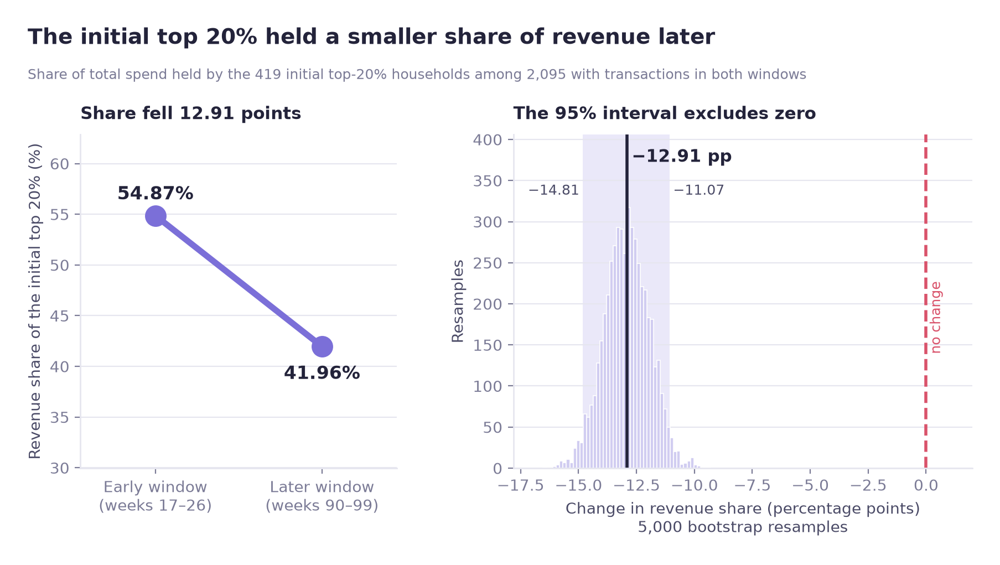

## 9. H4-1 결론

초반 상위 20%가 후반 성장의 주역이라는 가설은 데이터와 맞지 않았다. **상위 고객의 절대 지출과 매출 비중이 모두 줄었다.** 같은 기간 나머지 80%에서는 지출이 증가했다.

이를 고객 지출의 **탈집중화 또는 수렴 패턴**으로 기술할 수 있다. 다만 상위 집단이 매장에서 아예 이탈한 것인지, 중간 집단의 구매가 활발해진 것인지는 이 비교만으로 알 수 없다. 그래서 H4-2로 이어갔다.

## 10. H4-2: 신규·재활성화 고객 정의

나머지 80%의 매출 증가가 신규 유입 덕분인지 기존 고객의 성장 덕분인지 확인했다.

- **신규:** 전체 기록에서 첫 구매가 안정구간 시작인 17주 이후에 나타난 가구
- **재활성화:** 신규가 아니면서 13주(91일) 이상의 구매 공백이 있었던 가구
- **기존:** 위 두 조건에 해당하지 않는 가구

서로 겹치지 않도록 분류하고 전체 가구 수와 일치하는지 확인했다. 아래 2×2 표는 17~99주에 거래가 있는 2,492가구가 대상이며, 나머지 8가구(기존 7, 재활성화 1)는 17주 이전이나 99주 이후에만 거래했다.

## 11. H4-2: 2×2 교차표와 카이제곱 검정

| 고객 상태 | 가구 수 |
|---|---:|
| 기존 | 1,565 |
| 재활성화 | 726 |
| 신규 | 209 |
| **합계** | **2,500** |

| 초기 지출 집단 | 기존 | 신규·재활성화 |
|---|---:|---:|
| 나머지 80% | 1,127 (56.5%) | **866 (43.5%)** |
| 상위 20% | 431 (86.4%) | **68 (13.6%)** |

- 최소 기대빈도: **187**로 카이제곱 검정의 일반적인 빈도 조건 충족
- 카이제곱 검정: **p = 1.5 × 10⁻³⁴**
- **Cramér's V = 0.246**

초기에 지출이 낮았던 가구에는 신규·재활성화 비율이 훨씬 높았다. 상위 지출 집단과 고객 상태 사이의 **연관성**은 확인됐다. 하지만 신규·재활성화 고객이 실제 매출 증가액의 주된 원인인지는 별도로 계산해야 한다.

## 12. H4-2: 매출 증가액의 실제 분해

나머지 80% 집단이 늘린 지출을 기존 고객과 신규·재활성화 고객으로 나눴다.

| 나머지 80% 안의 고객 상태 | 가구 비중 | 증가액 기여 비중 | 지출 변화 중앙값 |
|---|---:|---:|---:|
| 기존 | 56.5% | **70.0%** | **51.78** |
| 신규·재활성화 | 43.5% | **30.0%** | **10.26** |

신규·재활성화 고객은 인원으로는 43.5%였지만 지출 증가액에는 30%를 기여했다. 나머지 증가액의 70%는 **기존 고객**에게서 나왔다.

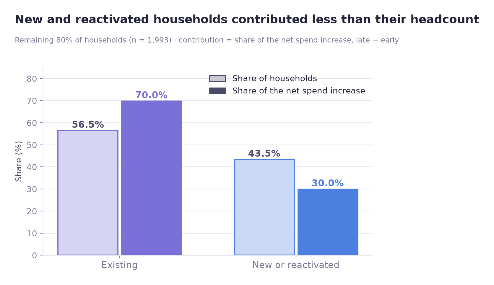

두 집단의 변화량을 Mann–Whitney U로 비교한 결과:

- `p = 0.000928` (Bonferroni 기준 통과)
- Rank-biserial 효과 크기 **0.086**
- 공통언어 효과 크기 **0.457**
- 비교 대상: 나머지 80% 가구 **1,993명**

통계적으로 차이가 감지되었지만 효과 크기는 작았다. **유의한 p-value가 곧 실무적으로 큰 차이를 뜻하는 것은 아니다.**

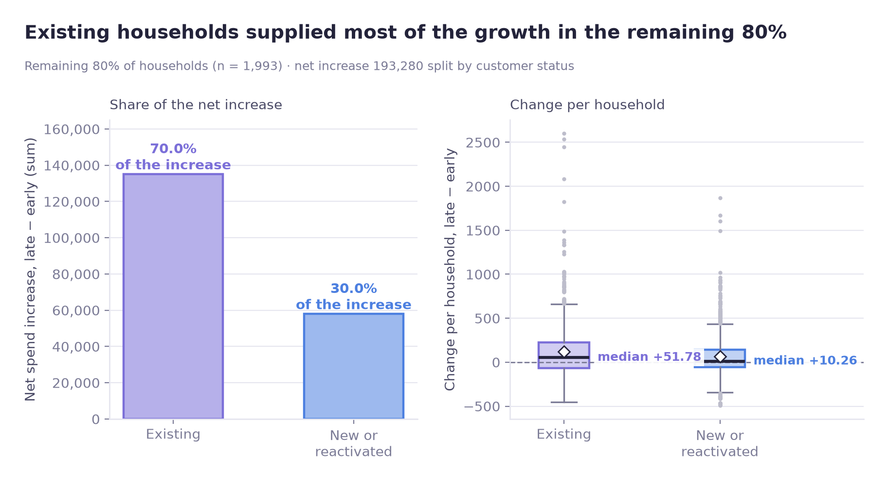

## 13. H4-2 결론

신규·재활성화 여부와 초기 지출 등급은 관련되어 있었다. 하지만 나머지 80%의 매출 증가액 가운데 **기존 고객의 기여가 70%**였다. 따라서 신규·재활성화 고객이 증가를 주도했다고 보기는 어렵다.

여기서 '기여'는 관측된 총증가액을 고객 상태에 따라 **회계적으로 분해한 몫**이다. 신규 고객을 유치한 행동의 인과효과를 측정한 수치는 아니다.

---

## 14. 추가 분석: 상위 20% 순위 하락 예측

통계 검정으로 지출 변화의 방향을 확인했다면, 다음 질문은 **어떤 초기 우수고객이 나중에도 상위권을 유지하는가**였다.

- 분석 대상: **17~26주** 상위 20% 고객 **499가구**
- 타깃: **90~99주**에도 상위 20% 유지(0) / 상위권 밖으로 이동(1)
- 모델: 로지스틱 회귀(해석용), 랜덤포레스트 + SHAP(비선형 확인용)
- 검증: **StratifiedKFold 5-fold**
- 성능: **PR-AUC, Recall** 중심 평가

순위에서 내려온 고객이 반드시 구매를 중단했다는 뜻은 아니다. 예측 대상의 이름을 실제 이탈(churn)과 혼동하지 않도록 구분했다.

## 15. 모델링에 사용할 테이블 점검

| 테이블 | 확인한 내용과 결정 |
|---|---|
| `hh_demographic` | 초기 상위 고객 499가구 중 180명(36.1%)은 정보가 없어 별도 표시. 전체 안정구간 인구통계 보유율 32.1%, 상위군 63.9% |
| `causal_data` | 결측·중복 없음. `DISPLAY`/`MAILER`에서 0은 미노출, 나머지는 노출로 확인 |
| `product` | `product_id`가 제품과 일대일로 연결되는지 검증 |
| `coupon_redempt` | DAY 225 이후 활동 시작. 초기 피처 구간(DAY 111~180)과 겹치지 않아 제외 |
| `campaign_table`, `campaign_desc` | 초기 구간에 시작된 캠페인이 없어 초기 시점 피처에서 제외 |

초기 시점에서 사용할 수 없던 캠페인 이력을 미래 정보를 끌어와 넣지 않는 데 신경 썼다.

## 16. 피처 엔지니어링

1. **인구통계 결측:** 180가구를 '정보없음'으로 처리했다. 원본 데이터의 `Unknown`은 응답값 중 미상이라는 뜻이라 결측과 구분했다.
2. **라벨 분포:** 상위권 하락 **44.7%**, 유지 **55.3%**로 심한 불균형은 없었다.
3. **수량 이상치:** 499가구의 초반 구간 장바구니당 평균 `QUANTITY`가 최대 **9,021**(예: 한 가구 **7,660**)까지 올라갔고, 단일 거래 행은 **41,686**개에 달했다. 중량/용량 기반 판매단위가 섞였을 수 있으므로 `avg_qty_per_basket` 대신 **`avg_items_per_basket`(장바구니당 고유 상품 수)**를 사용했다.
4. **프로모션 노출:** 단순 집계에서는 상위권을 떠난 고객의 `exposure_ratio`가 오히려 높았다. 다른 변수까지 고려했을 때도 같은 방향인지 회귀에서 확인했고, 보정 후에는 연관이 사라졌다(20절).

## 17. 인코딩

- **8개** 변수 표준화: 수치형 5개(`sales_early`, `n_baskets`, `avg_items_per_basket`, `category_diversity`, `exposure_ratio`)와 순서형 3개(`AGE_DESC`, `INCOME_DESC`, `HOUSEHOLD_SIZE_DESC`)를 로지스틱 회귀용으로 표준화했다. 이진 변수(`has_demo`, 원-핫 더미)는 표준화하지 않았다.
- 인구통계 보유 여부: `has_demo`라는 **이진 변수**를 별도로 생성
- 순서형 **4개:** 순서를 유지해 인코딩하고 결측은 별도로 검토해 최빈값을 활용. `KID_CATEGORY_DESC`는 VIF 단계(18절)에서 제거해 3개가 남았다.
- 명목형 **2개:** 원-핫 인코딩 적용. `HH_COMP_DESC`의 `Unknown`은 독립적인 범주로 유지

## 18. 다중공선성 확인

| 변수 | 제거 전 VIF |
|---|---:|
| `KID_CATEGORY_DESC_encoded` | **26.68** |
| `HOUSEHOLD_SIZE_DESC_encoded` | **26.49** |

자녀 수와 가구원 수가 거의 같은 정보를 담고 있어 `KID_CATEGORY_DESC_encoded`를 제거했다. 이후 모든 변수의 VIF가 5 이내로 내려갔고, `HOUSEHOLD_SIZE_DESC_encoded`는 **4.8**이 됐다. 최종 피처 수는 **18개**다.

## 19. 검증 분할

가구 수가 **499명**으로 많지 않아 단순한 한 번의 train/test 분리보다는 **5-fold StratifiedKFold**를 사용했다. 양성 44.7% / 음성 55.3% 비율이 각 폴드에서 비슷하게 유지되도록 구성했다.

단, 동일 가구에서 나온 데이터가 학습·평가에 섞이지 않도록 모델링 단위는 가구당 한 행이어야 한다. 또 이 교차검증 결과가 이후 시점의 실제 운영 성능을 보장하는 것은 아니다.

## 20. 모델 1: 로지스틱 회귀

| 지표 | 결과 |
|---|---:|
| 무작위 기준 PR-AUC | 약 **0.447** (양성률) |
| 로지스틱 회귀 PR-AUC | **0.685** |
| 실제 상위권 하락 가구 | 223명 |
| 하락인데 유지로 예측한 가구(FN) | **89명(약 40%)** |

PR-AUC는 무작위 기준보다 높았지만, 실제 하락 가구 약 40%를 놓쳤으므로 운영에 곧바로 적용하기에는 개선 여지가 있다.

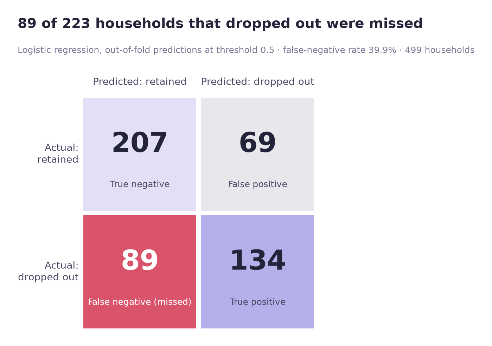

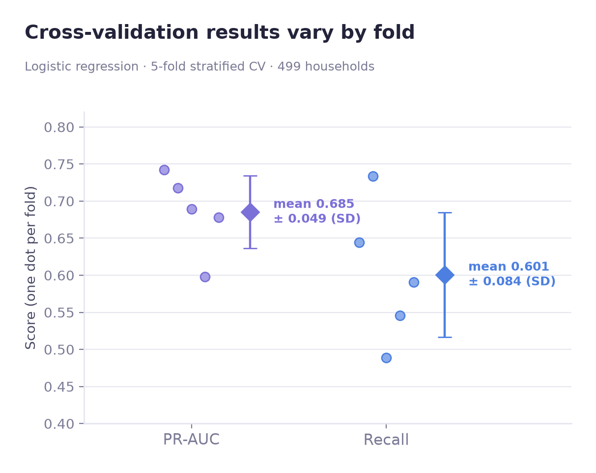

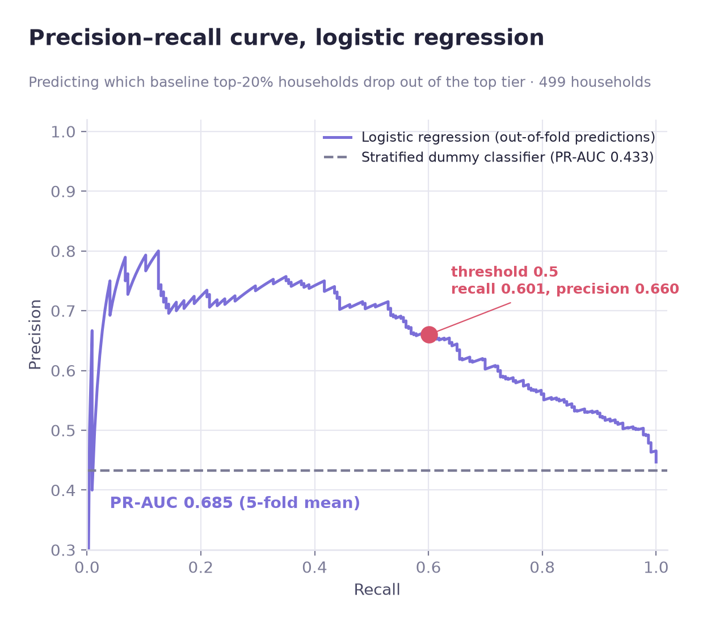

### 계수·오즈비 해석

수치형 변수의 오즈비는 표준편차(SD) 1 단위 기준이다. 구간은 예측에 쓴 정규화 모델을 가구 단위로 1,000회 재표본(seed 42)해 구한 95% 백분위 부트스트랩 구간이고, p-value는 같은 모델을 정규화 없이 다시 적합한 값이다. 구간이 1을 제외하면 연관이 확인된 것이고, 1을 포함하면 연관이 확인되지 않은 것이다.

| 변수 | 단위 | 오즈비 | 95% CI | p | 해석 |
|---|---|---:|---|---:|---|
| `has_demo` | 인구통계 기록 있음 vs 없음 | 0.32 | 0.19–0.51 | 5 × 10⁻⁵ | 연관 있음(가장 뚜렷) |
| `sales_early` | 1 SD당 (약 $429) | 0.64 | 0.42–0.85 | 0.009 | 연관 있음 |
| 소득 구간(`INCOME_DESC`) | 1 SD당 (순서형 12구간 중 약 2.0구간) | 0.73 | 0.55–0.92 | 0.007 | 연관 있음 |
| `category_diversity` | 1 SD당 (약 20.6개 카테고리) | 0.74 | 0.55–1.00 | 0.047 | 연관 있음(경계: 상한 0.998) |
| `n_baskets` | 1 SD당 (약 23.1회) | 1.29 | 0.91–1.87 | 0.07 | 확인되지 않음 |
| `exposure_ratio` | 1 SD당 (약 0.079) | 0.96 | 0.78–1.18 | 0.71 | 확인되지 않음 |

- **`has_demo`:** 인구통계 정보가 있는 고객은 상위권 하락과 음의 관련성을 보였다. 고객 참여도와 관련 있을 수 있지만 설문 응답이 순위 하락을 막는다는 증거는 아니다.
- **소득 구간:** 기준 범주와 비교하는 범주형이 아니라 순서형 코드다. Under 15K(0)부터 250K+(11)까지 12개 구간이며, 오즈비는 1 SD(약 2구간) 차이 나는 가구를 비교한 값으로 소득이 높을수록 하락 가능성이 낮았다. 설문 정보가 없는 180가구는 가장 흔한 구간(50–74K)으로 채웠고 `has_demo`로 구분된다.
- **`sales_early`, `category_diversity`:** 초기 지출과 구매 카테고리 다양성이 높을수록 하락 가능성이 낮은 방향이었다. `category_diversity`는 구간이 1을 간신히 벗어난다.
- **`exposure_ratio`, `n_baskets`:** 다른 변수를 고려하면 연관이 확인되지 않았다. 방문 횟수의 점추정(1.29)은 위험이 높은 쪽이지만 구간이 1을 포함하므로 위험 요인으로 읽으면 안 된다.
- **주거 소유 관련 범주:** 일부 셀의 표본이 매우 작아 추정치를 해석하지 않았다.

설명변수의 오즈비는 해당 변수와 타깃 사이의 조건부 연관성을 나타낸다. 무작위 배정한 요인이 아니므로 고객 행동을 바꾸면 같은 비율로 결과가 달라진다는 뜻은 아니다.

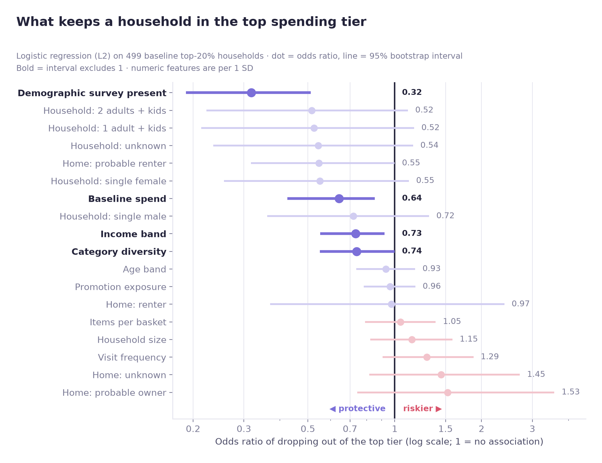

## 21. 모델 2: 랜덤포레스트와 SHAP

랜덤포레스트는 로지스틱 회귀보다 Recall이 낮았다(교차검증 0.529 vs 0.601). 표본 499개에서 복잡한 비선형 모형의 장점이 충분히 나오지 않았을 가능성이 있다. 따라서 현재 데이터에서는 **로지스틱 회귀를 주 모델**로 보는 편이 낫다고 판단했다.

SHAP 변수 중요도 상위 항목은 다음과 같았다.

1. `has_demo`
2. `sales_early`
3. `category_diversity`
4. `INCOME_DESC`
5. `avg_items_per_basket`

로지스틱 회귀에서 중요하게 나타난 변수와 상당 부분 겹쳤다. SHAP에서는 비선형 패턴도 보였다. `sales_early`는 평균 SHAP 값이 최하위 10분위 +0.091에서 9분위 −0.082, 최상위 10분위 −0.084로 내려갔다. 초반 지출이 약 1,250을 넘으면 지출이 더 커져도 예측이 더 움직이지 않았다(**포화**). `category_diversity`는 달라서, 약 77개 카테고리 이하에서는 평균 SHAP이 거의 일정(약 +0.03)했고 높은 쪽에서는 계속 내려가(최상위 10분위 −0.061) 상단 포화는 없었다. 다만 이 결과만으로 특정 고객에게 마케팅을 했을 때 효과가 더 크다고 단정할 수는 없다.

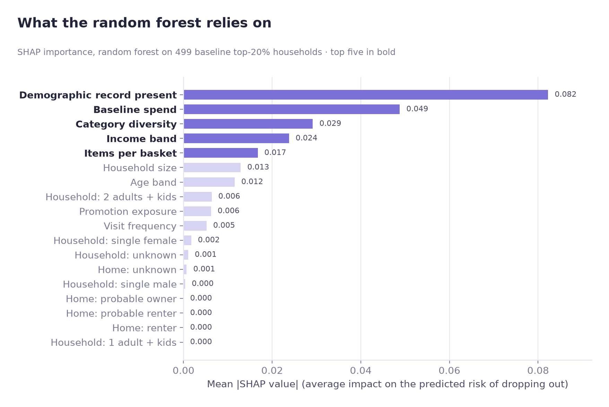

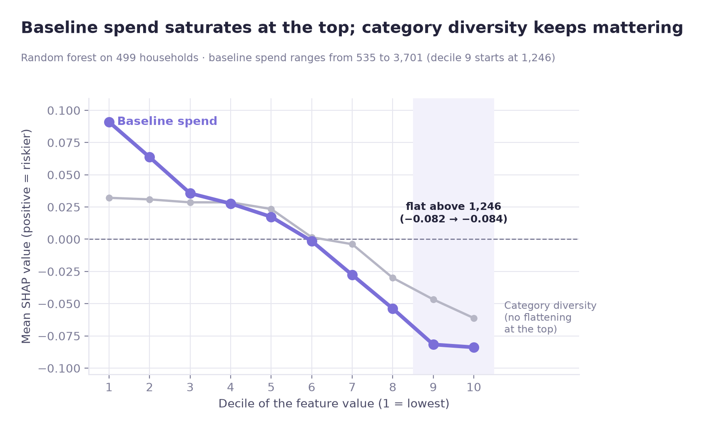

## 22. 마케팅에서 FN과 FP를 다르게 보는 이유

- **False Negative(FN):** 상위권에서 내려올 고객인데 '유지'로 분류해 선제적으로 접촉하지 못하는 경우
- **False Positive(FP):** 유지할 고객을 '하락 위험'으로 분류해 불필요한 마케팅 비용이 발생하는 경우

우수고객을 놓치는 비용이 불필요한 캠페인 한 번보다 높다면 Recall에 무게를 둘 수 있다. 다만 실제 비용·캠페인 효과 자료가 없으므로 최적 임계값은 계산하지 않았다. **Recall을 중시하는 기준은 운영 가정이지 검증된 비용 최적해는 아니다.**

## 23. 예측 모델 추가 검증

- **Permutation test:** `p = 0.001`(1,000회 순열, 달성 가능한 최솟값)로 임의 라벨보다 나은 패턴을 확인
- **Dummy classifier:** 층화 더미 분류기보다 성능이 높음(PR-AUC 0.685 vs 0.433)
- **Learning curve:** 검증 PR-AUC가 훈련 가구 119명에서 0.652였다가 마지막 다섯 구간에서는 0.680~0.687로 유지됐고, 훈련·검증 점수가 수렴했다(전체 크기에서 0.682 vs 0.685). 뚜렷한 훈련·검증 격차는 없었다.

따라서 학습한 관계가 단순한 우연만으로 보이지는 않았다. 검증 곡선이 평평해, 이 모델에서는 가구 수를 크게 늘려도 결과가 달라질 것이라는 근거는 없다. 다른 시점·다른 소매업 데이터에서도 같은 성능이 나온다는 보장은 없다.

## 전체 결론과 남은 질문

| 확인하려던 내용 | 분석 결과 |
|---|---|
| 상위 20%가 매출 증가를 이끌었는가? | **아니었다.** 초기 상위 집단의 지출과 매출 비중은 감소 |
| 나머지 80%는 왜 증가했는가? | 증가액의 **70%**는 기존 고객, **30%**는 신규·재활성화 고객에게서 관찰 |
| 고객 상태와 상위 여부가 연관되는가? | 연관성 확인, `Cramér's V = 0.246` |
| 어떤 상위 고객이 순위에서 내려오는가? | 일부 관련 변수를 찾았고 로지스틱 모델 PR-AUC **0.685**, 하지만 FN이 적지 않음 |

실무적으로는 초기 우수고객의 지출 규모만 보는 것보다 **구매 빈도, 카테고리 다양성, 기존 고객군의 성장**을 함께 볼 필요가 있다. 다음 단계에서는 상위 20% 순위 하락과 실제 거래 중단을 구분하고, 캠페인 비용과 증분 반응을 연결해 개입 우선순위를 평가하는 것이 좋겠다.

## 실행 방법

```
pip install -r requirements.txt
```

버전은 노트북을 실행한 Python 3.11 환경 기준으로 고정했다.

1. Dunnhumby *The Complete Journey* CSV를 `data/`에 내려받는다(`transaction_data`, `hh_demographic`, `product`, `causal_data`, `campaign_table`, `campaign_desc`, `coupon`, `coupon_redempt`). git에는 올라가지 않는다.
2. 저장소 루트에서 아래 순서로 노트북을 실행한다. 경로와 `SEED = 42`는 `config.py`에서 정한다.

   ```
   python -m nbconvert --to notebook --execute --inplace <notebook>.ipynb
   ```

   | # | 노트북 | 저장 결과 |
   |---|---|---|
   | 1 | `dunnhumby_data_overview` | `outputs/`: 주간 매출과 추세선 적합 |
   | 2 | `gap_analysis` | — |
   | 3 | `h4_transaction_eda` | `outputs/`: 순위 안정성, 로렌츠, 지니, 집중도, 가구 수 |
   | 4 | `h4_normality_variance` | `outputs/`: 패널 요약, 정규성·Levene, 민감도, Jaccard |
   | 5 | `h4_nonparametric_tests` | `outputs/`: 검정 A~C, 비중 부트스트랩(검정 D), Bonferroni 표 |
   | 6 | `h4_2_crosstab` | `outputs/`: 고객 상태 집계, 교차표, 카이제곱, 기여분, 제외 가구 |
   | 7 | `ml_tables_eda` | `outputs/`: 원천 테이블 점검 |
   | 8 | `h4_ml_feature_engineering` | `outputs/`: 라벨 요약, 피처 테이블(`outputs/intermediate/`) |
   | 9 | `h4_ml_encoding` | `outputs/`: VIF, 인코딩 요약, 인코딩 테이블(`outputs/intermediate/`) |
   | 10 | `h4_ml_model_training` | `outputs/`: CV 지표, 혼동행렬, 오즈비, 기준선, 임계값 |
   | 11 | `h4_ml_rf_shap` | `outputs/`: 랜덤포레스트 CV, SHAP 요약, 포화 10분위 |
   | 12 | `h4_figures` | `images/`: 모든 그림(`outputs/`에서 그림, 투명 버전은 `TRANSPARENT = True`) |

   3~6번은 서로 독립이고, 8 → 9 → 10 → 11번은 순서대로 실행해야 하며, 12번은 마지막에 실행한다.
3. 이 README의 모든 숫자는 `outputs/`의 CSV에서 나온다. 가구 단위 중간 파일은 `outputs/intermediate/`에 저장되며 커밋하지 않는다. 새 커널에서 두 번 실행해도 CSV가 같다.

## 분석의 한계

- 비교 기간 선택과 초기 지출 순위 고정 때문에 평균회귀 효과를 완전히 배제할 수 없다.
- 그룹별 매출 변화는 관찰된 패턴이며 원인까지 확인한 것은 아니다.
- 신규·재활성화 분류는 구매 기록에 따른 조작적 정의다. 데이터 관측 이전 고객 이력까지 알 수 있는 것은 아니다.
- 인구통계 결측 여부가 모델에서 중요하게 나왔지만, 결측이 고객 참여도 등 관측되지 않은 요소의 대리변수일 수 있다.
- 499명으로 모델을 평가했으므로 임계값과 성능 안정성에 주의가 필요하다.
- 이 모델의 목표는 실제 이탈이나 고객 생애가치가 아니라 **상위 지출 순위 유지 여부**다.

**정리:** 예상과 달리, 매출 증가의 중심은 초기 상위 20%가 아니었다. 나머지 고객군의 성장 중에서도 신규 유입보다는 기존 고객의 지출 확대가 더 큰 몫을 차지했다. 머신러닝 단계에서는 상위권 하락을 어느 정도 구분할 수 있었지만, 이것을 바로 고객 이탈 예측이나 개입 효과로 해석해서는 안 된다.
